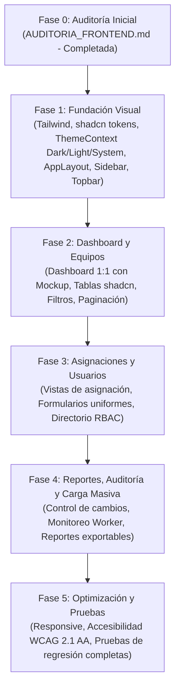

# AUDITORÍA INICIAL DEL FRONTEND — Pry_CRUD_INVENTARIO

**Fecha de ejecución:** 4 de noviembre de 2026  
**Rama de trabajo:** `redesign/frontend-foundation`  
**Estrategia:** KEEP (Conservación absoluta de lógica, estado, integraciones y cero modificaciones en el backend)  
**Referencia visual aprobada:** Mockup Dashboard Logistics Dark (`media_1793824440033_68d749b4.jpg` y `https://demos.shadcndashboard.dev/dashboards/logistics?mode=dark`)

---

## 1. Arquitectura Encontrada

### 1.1. Pila Tecnológica Real
- **Framework:** React `19.3.0` (JavaScript / JSX puro, sin TypeScript).
- **Bundler:** Vite `8.2.0` con plugin `@vitejs/plugin-react` `6.1.2`.
- **Enrutamiento:** Enrutamiento centralizado basado en estado en `App.jsx` (`currentView` con 10 vistas principales: `dashboard`, `equipos`, `asignaciones`, `control-cambios`, `mis-equipos`, `reportar-fallo`, `carga-masiva`, `tareas`, `reportes`, `usuarios`).
- **Gestión de Estado:** Contextos nativos de React:
  - `AuthContext`: Manejo de autenticación JWT (token y usuario persistidos en `localStorage`), control de roles (`ADMIN`, `TECNICO`, `EMPLEADO`) y helpers de permisos (`canManageInventory`, `canManageUsers`).
  - `ToastContext`: Sistema flotante no bloqueante con accesibilidad (`role="status"`, `aria-live`).
- **Capa HTTP y Servicios:** `api/client.js` implementa un cliente unificado (`request`) con interceptor de errores 401 (purga de credenciales y recarga controlada) y exportación de métodos fuertemente tipados por módulo.
- **Estilos Actuales:** Un único archivo monolítico `styles.css` de **4.945 líneas de CSS**, con variables personalizadas (`:root` y `[data-theme="dark"]`), estilos específicos para cada vista e inline styles superpuestos. No hay Tailwind CSS ni PostCSS instalados en el proyecto base.

---

## 2. Inventario Real de Módulos

| Módulo | Archivo Fuente | Líneas | Responsabilidad y Operaciones Reales | Roles Autorizados |
| :--- | :--- | :---: | :--- | :--- |
| **Autenticación (Login)** | `frontend/src/pages/Login.jsx` | 268 | Inicio de sesión con correo y contraseña, toggle de visibilidad, manejo de errores JWT y enlaces a políticas legales. | Público / Todos |
| **Dashboard** | `frontend/src/pages/Dashboard.jsx` | 563 | Métricas agregadas (`api.getMetricasDashboard`), resumen operativo (total equipos, usuarios activos, tareas worker), disponibilidad (asignados, custodia, préstamo, baja), semáforo de salud, distribución (marcas, sedes, SO, tipos) y feed de eventos recientes (`api.getEventosRecientes`). | Todos (`ADMIN`, `TECNICO`, `EMPLEADO` filtrado) |
| **Inventario de Equipos** | `frontend/src/pages/EquiposList.jsx` | 2.956 | Catálogo general y filtrado por 10 submódulos de hardware (`todos`, `equipos_prestamos`, `alquiler`, `prestamos`, `devoluciones`, `impresoras`, `elementos`, `perifericos`, `ups`, `bajas`). Incluye 7 modales: creación/edición, dar de baja, registro de préstamo, devolución a custodia, hoja de vida técnica, firma digital de acta y modal de histórico. Genera y descarga `.xlsx` y `.docx`. | `canManageInventory` (`ADMIN` / `TECNICO`) |
| **Asignaciones de Hardware** | `frontend/src/pages/Asignaciones.jsx` | 586 | Gestión de activos en custodia vinculados a colaboradores, áreas o sedes. Permite asignar equipos disponibles, generar y descargar actas de entrega firmadas digitalmente y visualizar historial del colaborador. | `canManageInventory` (`ADMIN` / `TECNICO`) |
| **Control de Cambios (Auditoría)** | `frontend/src/pages/ControlDeCambios.jsx` | 190 | Trazabilidad inmutable de eventos (`CREACION`, `ASIGNACION`, `PRESTAMO`, `DEVOLUCION`, `REPORTE_FALLO`, `DE_BAJA`). Filtros por tipo de evento, buscador textual y paginación. | `canManageInventory` (`ADMIN` / `TECNICO`) |
| **Carga Masiva Asíncrona** | `frontend/src/pages/CargaMasiva.jsx` | 908 | Importación por lotes de hojas de cálculo de inventario. Flujo en 3 pasos (subir archivo, procesamiento en Worker con polling de estado, y reporte de resultados/errores por fila). Descarga y carga de plantillas oficiales `.xltx` de inventario y hoja de vida. | `canManageInventory` (`ADMIN` / `TECNICO`) |
| **Monitor de Tareas Worker** | `frontend/src/pages/TareasWorker.jsx` | 284 | Supervisión en tiempo real de la cola asíncrona `tareas_worker` (estados: `PENDIENTE`, `EN_PROCESO`, `COMPLETADO`, `FALLIDO`). Auto-refresco cada 4 segundos e inspección de logs y detalles de procesamiento. | `canManageInventory` (`ADMIN` / `TECNICO`) |
| **Centro de Reportes** | `frontend/src/pages/Reportes.jsx` | 289 | Visualización de indicadores ejecutivos, distribución por sedes y exportación masiva del catálogo a formato CSV. | `canManageInventory` (`ADMIN` / `TECNICO`) |
| **Directorio de Usuarios (RBAC)** | `frontend/src/pages/UsuariosList.jsx` | 579 | Administración de cuentas de usuario del sistema. Operaciones CRUD, conmutación de estado activo/inactivo (`toggleUsuarioActivo`), asignación de roles (`ADMIN`, `TECNICO`, `EMPLEADO`) y paginación. | `canManageUsers` (`ADMIN`) |
| **Portal Empleado (Mis Equipos)** | `frontend/src/pages/MisEquipos.jsx` | 313 | Vista de autoservicio exclusiva para colaboradores: consulta de equipos bajo su custodia personal y modal para reportar fallos técnicos o incidencias. | `EMPLEADO` (y fallback) |

---

## 3. Componentes Reutilizables Existentes

- **`components/Sidebar.jsx` (351 líneas):** Menú lateral con conteos de hardware en tiempo real vía `api.getConteos()`, filtrado por roles y disparador de políticas.
- **`components/Icons.jsx` (367 líneas):** Conjunto de 35+ componentes SVG inline reutilizables (reemplazables o integrables con `lucide-react`).
- **`components/Pagination.jsx` (102 líneas):** Paginación accesible con salto de página y selector de elementos por página.
- **`components/ModalFirmaActa.jsx` (388 líneas):** Panel de captura de firma manuscrita sobre HTML5 Canvas (soporte mouse y táctil), subida de firma en imagen (PNG/JPEG) y persistencia en `localStorage`.
- **`components/SelectOrCustomInput.jsx` (88 líneas):** Control híbrido selector/entrada manual para tipos de hardware, marcas y sedes.
- **`components/ConfirmModal.jsx` (165 líneas):** Diálogo de confirmación accesible (`role="alertdialog"`, `Escape` y foco automático en cancelar).
- **`components/Skeleton.jsx` (112 líneas):** Marcadores de posición estructurales (`SkeletonBox`, `SkeletonKpiCard`, `SkeletonTableRow`).
- **`components/StorageConsentBanner.jsx` (81 líneas):** Banner de transparencia de almacenamiento local y Habeas Data.
- **`components/PrivacyTermsModal.jsx` (221 líneas):** Modal institucional de términos y Ley 1581 de 2012.
- **`pages/HistorialModal.jsx` (98 líneas):** Línea de tiempo modal para eventos individuales de un equipo.

---

## 4. Dependencias Actuales (`frontend/package.json`)

```json
{
  "dependencies": {
    "react": "^19.3.0",
    "react-dom": "^19.3.0"
  },
  "devDependencies": {
    "@vitejs/plugin-react": "^6.1.2",
    "vite": "^8.2.0"
  }
}
```

*Diagnóstico de dependencias:*  
Para dar cumplimiento al **Documento Maestro**, se requiere incorporar en el frontend:
- `tailwindcss`, `postcss`, `autoprefixer` para el motor de clases utilitarias y tokens.
- `lucide-react` para la iconografía estandarizada empresarial del mockup.
- `clsx` y `tailwind-merge` para composición de clases dinámica (`cn(...)` estándar de shadcn).

---

## 5. Problemas Encontrados

1. **Estilos Monolíticos y Duplicación (`styles.css`):**
   - 4.945 líneas de CSS con selectores altamente específicos y difíciles de sobreescribir.
   - Numerosos estilos en línea (`style={{ ... }}`) que eluden el sistema de variables y generan inconsistencias visuales.
2. **Alta Complejidad y Tamaño en Componentes Clave:**
   - `EquiposList.jsx` tiene casi 3.000 líneas combinando 7 modales, lógica de negocio, manipulación de tablas y validaciones en un único archivo.
3. **Disparidad con el Mockup Aprobado:**
   - El mockup (`media_1793824440033_68d749b4.jpg`) define una jerarquía limpia inspirada en shadcn Logistics Dark:
     - Logotipo corporativo 3D isomórfico con branding "Inventario TI / Pry_CRUD_INVENTARIO".
     - Navegación lateral unificada con badges discretos e icono Home azul activo.
     - Topbar con buscador global `Buscar equipos, usuarios... (Ctrl + K)`, campanita con badge y perfil `JD Juan Pérez / Administrador`.
     - Dashboard con 3 tarjetas KPI con curvas sparkline, tabla de Movimientos Recientes con badges semánticos, panel de Pendientes de Atención con contador y accesos rápidos inferiores.
4. **Sistema de Temas Incompleto:**
   - La implementación actual solo alterna entre `dark` y `light`; carece de soporte para `system` (respetar la preferencia del SO automáticamente).
5. **Navegación Móvil y Responsive:**
   - Las tablas con más de 8 columnas sufren desbordamiento en resoluciones intermedias (tablets y pantallas compactas).

---

## 6. Riesgos de Refactorización y Mitigaciones

| Riesgo | Probabilidad / Impacto | Mitigación Obligatoria |
| :--- | :---: | :--- |
| **Riesgo 1: Alteración accidental del Backend** | Crítico | **Prohibido tocar cualquier archivo fuera de `frontend/`**. No modificar base de datos, endpoints, controladores ni rutas de API. |
| **Riesgo 2: Pérdida de contratos HTTP en `client.js`** | Alto | Mantener intactas las firmas de llamada, nombres de parámetros (`busqueda`, `estado`, `tipo`, `sede`, `area`, `modulo`), manejo de errores y parsing de respuestas. |
| **Riesgo 3: Ruptura de descarga de archivos binarios** | Alto | Preservar de forma exacta la lógica de blobs y headers para descarga de actas `.docx` y hojas de vida `.xlsx`. |
| **Riesgo 4: Fallas en Canvas de Firma Digital** | Medio | Mantener la lógica de captura táctil/mouse en `ModalFirmaActa.jsx`, asegurando que el string Base64 se envíe en el mismo formato al API. |
| **Riesgo 5: Regresiones de permisos RBAC** | Alto | Preservar las comprobaciones `canManageInventory` y `canManageUsers` de `AuthContext.jsx`. |

---

## 7. Archivos que Requieren Cambios

### 7.1. Configuración y Dependencias
- `frontend/package.json`: Agregar `tailwindcss`, `postcss`, `autoprefixer`, `lucide-react`, `clsx`, `tailwind-merge`.
- `frontend/postcss.config.js`: Archivo de configuración para PostCSS.
- `frontend/tailwind.config.js`: Definición de paleta corporativa Dark/Light, radios, fuentes y animaciones.
- `frontend/vite.config.js`: Configuración de alias de ruta `@/`.

### 7.2. Sistema de Tokens y Temas
- `frontend/src/styles.css`: Adaptar con directivas `@tailwind`, variables CSS para Dark/Light/System Mode y clases base shadcn.
- `frontend/src/context/ThemeContext.jsx`: Nuevo contexto para alternar fluidamente entre `dark`, `light` y `system`.

### 7.3. Componentes de Estructura y Layout
- `frontend/src/components/layout/AppLayout.jsx`: Contenedor maestro con Sidebar, Topbar y Page Container.
- `frontend/src/components/layout/Sidebar.jsx`: Rediseño fiel al mockup (branding 3D, navegación con Lucide icons, toggle de modo oscuro al fondo, versión `v1.0.0`).
- `frontend/src/components/layout/Topbar.jsx`: Buscador global con atajo `Ctrl+K`, notificaciones y avatar de usuario.

### 7.4. Vistas y Módulos
- `frontend/src/pages/Dashboard.jsx`: Rediseño 1:1 con el mockup definitivo (3 KPI cards con sparklines, tabla de movimientos recientes con badges semánticos, panel de pendientes y 3 accesos rápidos).
- `frontend/src/pages/EquiposList.jsx`: Modernización de la tabla con estilos shadcn, filtros discretos y modales uniformes.
- `frontend/src/pages/Asignaciones.jsx`, `UsuariosList.jsx`, `ControlDeCambios.jsx`, `CargaMasiva.jsx`, `TareasWorker.jsx`, `Reportes.jsx`, `MisEquipos.jsx`: Adaptación progresiva de tablas, formularios y tarjetas sin alterar su funcionalidad.

---

## 8. Plan de Implementación por Fases



---

## 9. Pruebas de Regresión Obligatorias

1. **Compilación de Producción:** Ejecutar `docker compose build frontend` verificando `0 errores` de compilación en Vite.
2. **Autenticación:** Login con usuario `ADMIN`, `TECNICO` y `EMPLEADO`; verificación de persistencia de token JWT y cierre de sesión.
3. **Dashboard:** Carga correcta de `api.getMetricasDashboard` y visualización de los 3 KPIs (Equipos registrados, Asignados, En mantenimiento).
4. **Inventario:** Conmutación entre los 10 submódulos de hardware (`todos`, `prestamos`, `alquiler`, `devoluciones`, `ups`, etc.); apertura de modales de creación y edición.
5. **Acta de Entrega:** Generación de acta `.docx` con firmas electrónicas e inspección del archivo descargado.
6. **Hoja de Vida:** Generación y descarga de plantilla y reporte `.xlsx`.
7. **Control de Cambios:** Renderizado cronológico de eventos de inventario con filtros de tipo.
8. **Carga Masiva:** Drag & drop de archivo Excel, visualización de progreso en worker y descarga de plantilla oficial.
9. **Temas:** Conmutación en tiempo real entre Dark Mode, Light Mode y System Mode sin recargar la página.
10. **Responsive:** Inspección visual y funcional en Desktop (1280px+), Tablet (768px-1024px) y Móvil (<768px).
