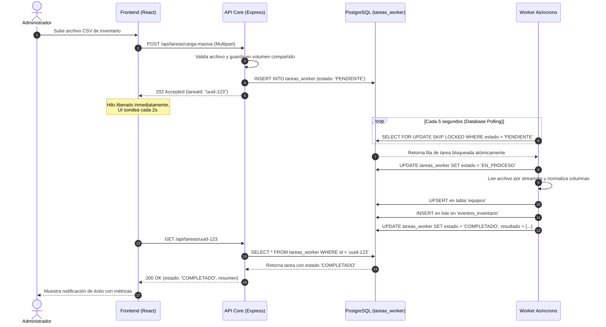

# Arquitectura del Sistema: Plataforma de Gestión de Activos TI

## 1. Visión General de la Arquitectura

El sistema implementa una arquitectura basada en microservicios contenerizados mediante **Docker Compose**, separando claramente las responsabilidades de presentación, lógica de negocio síncrona, procesamiento asíncrono y persistencia de datos.

```text
┌─────────────────────────────────────────────────────────────┐
│                      Navegador Web (Host)                   │
└──────────────────────────────┬──────────────────────────────┘
                               │ HTTP / JSON
                               ▼
┌─────────────────────────────────────────────────────────────┐
│               Red Docker Interna (inventario-net)           │
│                                                             │
│   ┌─────────────────────┐       ┌──────────────────────┐    │
│   │  frontend:3000 (80) │       │    api-core:5000     │    │
│   │  React + Vite/Nginx │──────▶│    Express + JWT     │    │
│   └─────────────────────┘       └──────────┬───────────┘    │
│                                            │                │
│                                            ▼                │
│       ┌──────────────────┐      ┌────────────────────┐      │
│       │ worker (Headless)│◀────▶│    postgres-db     │      │
│       │ Database Polling │      │   PostgreSQL 16    │      │
│       └────────┬─────────┘      └────────────────────┘      │
│                │                           ▲                │
│                ▼                           │                │
│       ┌──────────────────┐                 │                │
│       │  uploads-data    │─────────────────┘                │
│       │  (Volumen comp.) │                                  │
│       └──────────────────┘                                  │
└─────────────────────────────────────────────────────────────┘
```

---

## 2. Flujo de Procesamiento Asíncrono (Database Polling)

Para evitar la sobreingeniería de colas complejas (RabbitMQ, Kafka), se adoptó el patrón de **Database Polling** utilizando la capacidad nativa de PostgreSQL `SELECT ... FOR UPDATE SKIP LOCKED`, garantizando atomicidad y prevención de condiciones de carrera:



---

## 3. Modelo de Entidades y Trazabilidad

1. **`usuarios`**: Almacena credenciales hasheadas con bcrypt, número de cédula y rol (`ADMIN` o `EMPLEADO`).
2. **`equipos`**: Fuente única de verdad de los activos tecnológicos (laptops, servidores, impresoras, ups, etc.), con su estado de ciclo de vida (`FUNCIONAL`, `REVISAR`, `DAÑADO`, `DE_BAJA`) y referencia al responsable.
3. **`eventos_inventario`**: Registro inmutable de auditoría histórica. Cualquier cambio en un equipo (creación, asignación, cambio de estado, baja o carga masiva) genera un evento inmutable vinculado al usuario ejecutor.
4. **`tareas_worker`**: Cola de orquestación asíncrona que gestiona el ciclo de vida de los procesos pesados (`PENDIENTE` $\to$ `EN_PROCESO` $\to$ `COMPLETADO` / `FALLIDO`).
