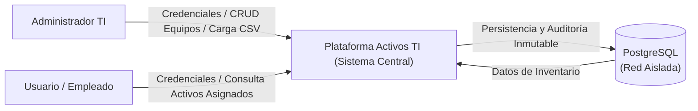
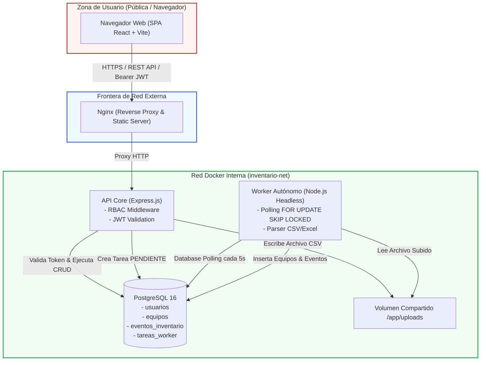

# Modelado de Amenazas: Metodología STRIDE y DFD

## Plataforma Avanzada de Gestión de Activos TI

Este documento describe la arquitectura de seguridad y la evaluación formal de riesgos mediante la metodología **STRIDE** y **Diagramas de Flujo de Datos (DFD)** para la plataforma de gestión de inventario tecnológico.

---

## 1. Diagrama de Flujo de Datos (DFD)

### DFD Nivel 0 (Contexto General)

### DFD Nivel 1 (Descomposición de Componentes y Límites de Confianza)

---

## 2. Matriz de Modelado de Amenazas STRIDE

| Categoría STRIDE | Amenaza Identificada | Impacto | Control de Mitigación Implementado |
| :--- | :--- | :--- | :--- |
| **S** (Spoofing) | Suplantación de identidad de un usuario legítimo o administrador mediante fuerza bruta o robo de tokens. | **Alto**: Un atacante podría acceder al inventario corporativo y reasignar equipos. | • Hashing de contraseñas con **bcrypt** (salt rounds = 10). • Tokens **JWT con firma HMAC SHA-256** y expiración configurable (`JWT_EXPIRES_IN=8h`). • Middleware de autenticación centralizado (`authenticateToken`). |
| **T** (Tampering) | Manipulación de datos en tránsito o alteración fraudulenta del historial de asignaciones de equipos. | **Crítico**: Pérdida de integridad en la custodia del hardware de la empresa. | • Registro obligatorio en la tabla inmutable **`eventos_inventario`** en cada creación, edición o baja. • Consultas SQL preparadas parametrizadas en `pg` para evitar inyección SQL (SQLi). • Red interna de Docker sin exposición de puertos de PostgreSQL a internet. |
| **R** (Repudiation) | Un administrador o empleado niega haber dado de baja o reasignado un equipo. | **Medio-Alto**: Imposibilidad de auditar responsabilidades operativas. | • Todo cambio en `eventos_inventario` almacena obligatoriamente `usuario_id`, fecha/hora UTC (`NOW()`) y snapshot detallado de los campos modificados en formato JSONB. |
| **I** (Information Disclosure) | Un empleado accede al listado completo de equipos de otros colaboradores o infraestructura crítica de servidores. | **Alto**: Exposición de números de serie, direcciones IP, marcas y asignaciones confidenciales. | • **RBAC Estricto a nivel de base de datos**: Si `rol === 'EMPLEADO'`, el query SQL inyecta forzosamente la cláusula `WHERE cedula_responsable = $1 OR usuario_asignado_id = $2`. El empleado físicamente no puede consultar equipos ajenos. |
| **D** (Denial of Service) | Saturación del hilo de ejecución del servidor al cargar archivos masivos CSV con miles de filas. | **Alto**: Bloqueo del API Core y degradación del servicio para todos los usuarios. | • **Patrón Asíncrono de Database Polling**: El API Core responde inmediatamente con HTTP `202 Accepted` tras registrar la tarea en `tareas_worker`. El procesamiento pesado lo asume el **Worker** en un proceso y contenedor totalmente aislado. |
| **E** (Elevation of Privilege) | Un usuario con rol `EMPLEADO` invoca endpoints para crear, modificar o eliminar equipos (`POST /api/equipos`). | **Crítico**: Modificación no autorizada del inventario corporativo. | • Middleware **`authorize(['ADMIN'])`** que intercepta las peticiones y responde con HTTP `403 Forbidden` si el rol en el token JWT no es estrictamente `ADMIN`. |

---

## 3. Prácticas DevSecOps "Shift-Left" Implementadas

1. **Secret Scanning:** Pipeline automático con **Gitleaks** para evitar commits accidentales de contraseñas o tokens.
2. **SAST (Static Application Security Testing):** Reglas de seguridad de **Semgrep** para detectar OWASP Top 10 en código JavaScript.
3. **SCA (Software Composition Analysis):** Escaneo con **Trivy** sobre dependencias `npm` y paquetes del sistema operativo base.
4. **Hardening de Contenedores:**
   * Imágenes mínimas basadas en Alpine Linux (`node:20-alpine`, `nginx:alpine`).
   * Ejecución bajo usuario sin privilegios (`USER node`).
   * Desacoplamiento de red y ausencia de puertos expuestos en el contenedor de base de datos y worker.
